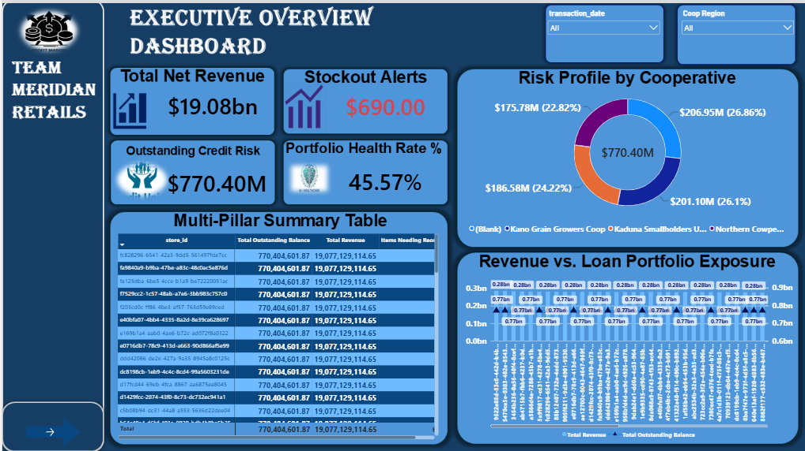
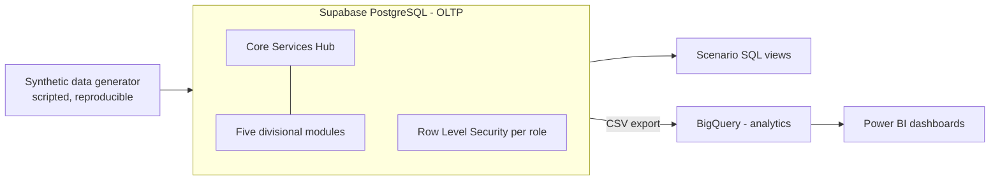
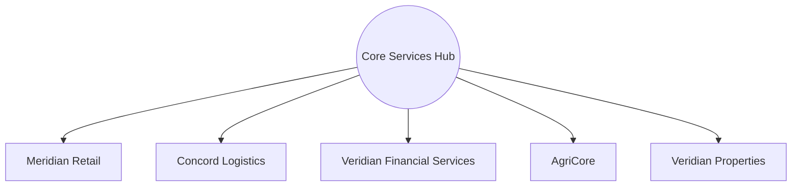

# Project Concord: The Veridian Unified Data Platform

**One governed PostgreSQL database for five disconnected business divisions, with an analytics layer in BigQuery and Power BI dashboards. Success was defined as four concrete stakeholder scenarios solved with working SQL.**

## The problem

Veridian's five divisions (Meridian Retail, Concord Logistics, Veridian Financial Services, AgriCore, Veridian Properties) ran on disconnected systems for two decades. Two earlier attempts to unify them failed from scope creep and over-ambitious schema design. This project fixed the scope up front and measured success by whether the platform could answer four named questions live.

## Architecture

The schema is **hub-and-spoke**. A Core Services Hub (customers, employees, suppliers and vendors, locations, product catalogue, a divisions lookup table) is referenced by five divisional modules.

- Two Supabase projects, a development one and a production one. Production was built from the same migration scripts, without test rows.
- Row Level Security on every table, tested end to end with one test account per division plus an executive account.
- Consent-flag columns for retail loyalty personalisation and financial-services visibility, following the Nigerian Data Protection Act.
- The analytics layer was loaded into BigQuery from exported CSVs rather than an automated ELT pipeline.

ERDs and the data dictionary are listed under [Documentation](#documentation).

## The four scenarios

| # | Question | How it was solved | Result |
|---|---|---|---|
| 1 | Can a harvest shortfall at AgriCore warn a retail store before a delivery fails to arrive? | `retail_supply_shortage_signal` follows `harvest_batches` → `processing_runs` → `wholesale_shipments` → `shipments`, comparing each harvest with that farm's own historical average. | Harvests under 60% of average are flagged high risk, 60-85% moderate. Each flagged row is tied to a destination store and shipment status. |
| 2 | Can a farmer's supply history with AgriCore inform a lending decision? | Two additive RLS policies give the finance role read access to `farms` and `harvest_batches` only. `vfs_borrower_supply_history` joins them per farmer. | VFS can read the data, and the retail test account querying the same table gets an empty result. |
| 3 | Can Logistics see a warehouse's lease status before a truck arrives? | A `lease_status` column plus a partial unique index allows at most one active lease per tenant. A foreign key links warehouse to property, and RLS lets Logistics read warehouses. `logistics_warehouse_lease_status` joins warehouse, property, active lease and tenant. | The platform now separates verified, currently leased capacity from capacity nobody has confirmed. |
| 4 | Can the group CEO get a same-day consolidated revenue view instead of waiting 21 days? | `group_consolidated_revenue_snapshot` unions retail POS revenue, active lease rent and VFS merchant settlements (keyed by division). | One query returns daily consolidated figures across divisions. |

Run any of them: `SELECT * FROM retail_supply_shortage_signal LIMIT 20;` and likewise for the other three views.

## Dashboards

Four Power BI dashboards, built toward the scenarios rather than as general reporting: store inventory signals, farmer credit and risk exposure, retail and sales overview, and an executive overview. Screenshots are in `docs/dashboards/`.

## Design decisions

- **No foreign keys into VFS from any other division.** VFS data is reached only through named RLS grants, never a structural join. The `wallet` payment method in retail is a read-only tag, not a reference.
- **Indexes on foreign keys.** The hub is looked up constantly from the spokes. This trades some insert and update cost and disk space for fast reads, which suits a read-heavy dashboard workload.
- **Deliberate denormalisation.** `inventory_stock_levels` is a mutable current-state row per store and product, because floor stock lookups need to be instant.
- **Exclusive-reference pattern.** Where an entity can point to exactly one of several kinds of thing (loans, tenants, wholesale shipments), nullable columns plus a CHECK constraint enforce that exactly one is set.
- **Constraints in the database.** Column types and bounded values use CHECK constraints, so bad data is rejected at the source.
- **UUIDs instead of serial IDs**, to avoid look-alike IDs across tables.
- **RLS gotcha worth knowing.** Supabase enables RLS on every new table, so a new table is unreadable through the REST API until it has an explicit policy. I found this while testing executive access, and checked it with `pg_class.relrowsecurity` and `pg_policies`.

## Known limitations

- Synthetic data gives each farm a single harvest, so the supply-history join in scenario 2 works but shows no multi-year depth.
- The consolidated revenue view does not include Logistics freight or AgriCore wholesale revenue, because the schema has no clean sellable-amount column for either.
- Only the Properties tables needed for the lease scenario (properties, leases, tenants) are built. The rest of that module is designed but not implemented.
- Query performance review (`EXPLAIN ANALYZE`) is still in progress.
- Dashboard figures (revenue, credit exposure, reorder alerts) come from generated data and say nothing about real performance.

## Documentation

| Document | What it covers |
|---|---|
| [ERDs](erd_links.md) | Level 1 and level 2 entity-relationship diagrams of the hub and the five divisional modules |
| [Data dictionary](docs/data_dictionary.md) | Every table and column, with types, constraints and purpose |
| [Final report](Project_Concord_Final_Report.docx) | The business problem, the four scenario solutions, dashboards, design decisions and limitations (status as of 25 August 2026) |
